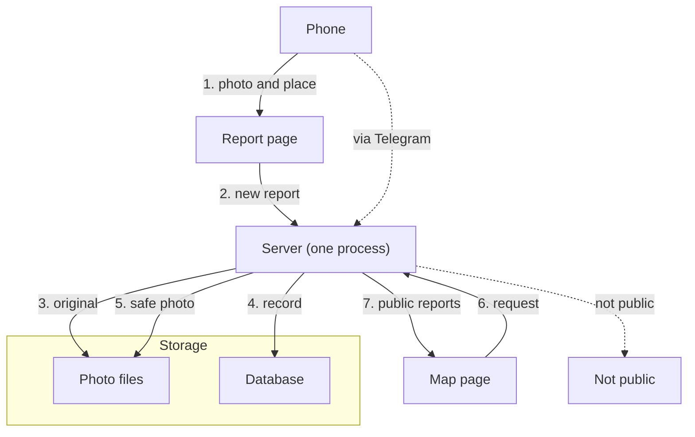

# From a phone to the map

*For: New engineer*

**Goal.** A user sends a photo of a street problem, and the report is shown on a public map.

- If blur does not work or the photo is graphic, the report is not public.
- If there is no place, the server returns an error.
- Many flags take a report off the map.

1. The user sends a photo and a place from the report page.
2. The report page sends a new report to the server.
3. The server stores the original photo as a private file.
4. The server writes a report record.
5. A worker blurs faces and plates and stores the safe photo.
6. The map page asks the server for public reports.
7. The server returns public reports; the map shows them.
