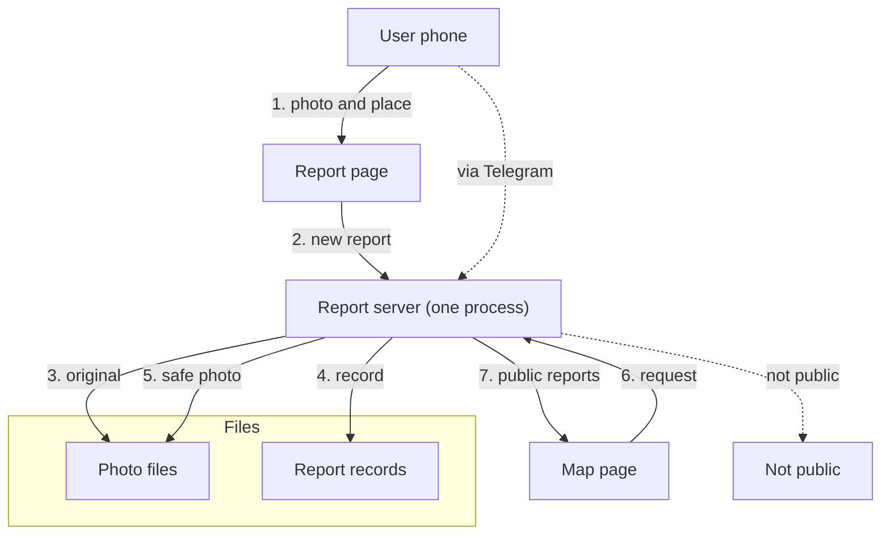

# From a phone to the map

*For: New engineer*

| Failure |
| --- |
| Report server → Not public: not public |

**Goal.** A user sends a street photo and the map shows the report.

| What can go wrong |
| --- |
| If blur does not work, the report is not public. |
| If there is no place, the server returns an error. |
| Many flags take a report off the map. |

1. The user sends a photo and a place.
2. The page sends the report to the server.
3. The server stores the original photo.
4. The server writes a record.
5. A worker blurs faces and plates.
6. The map asks for public reports.
7. The server returns the public reports.
