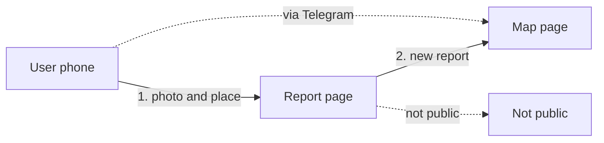

# From a phone to the map

*For: Product*

| Failure |
| --- |
| Report page → Not public: not public |

**Goal.** A user sends a street photo and the map shows the report.

| User impact |
| --- |
| No account is needed. |
| Faces and plates are hidden first. |
| A photo not fit for public is not shown. |
