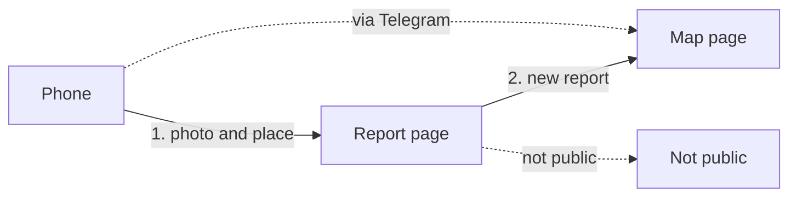

# From a phone to the map

*For: Product*

**Goal.** A user sends a photo of a street problem, and the report is shown on a public map.

- No account is needed.
- Not shown at once: faces and plates are made hard to read first.
- A photo not fit for public is not shown.
