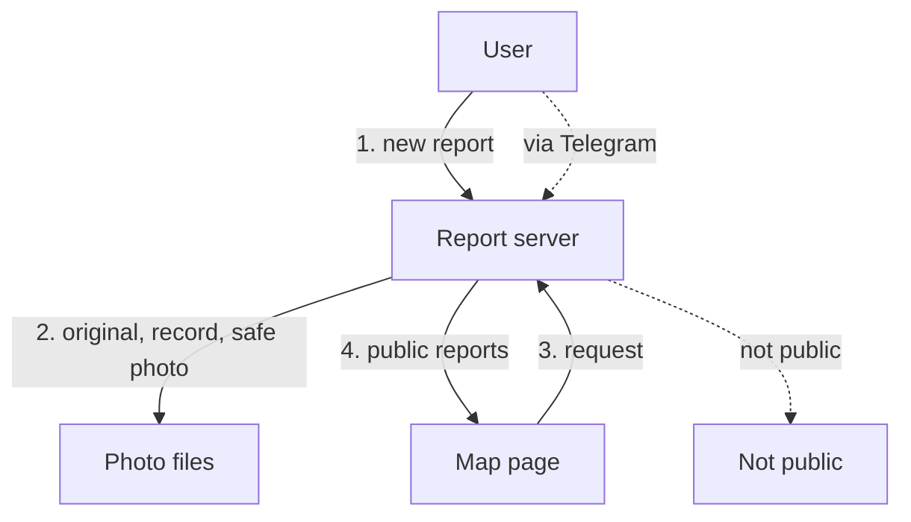

# From a phone to the map

*For: Tech lead*

| Failure |
| --- |
| Report server → Not public: not public |

**Goal.** A user sends a street photo and the map shows the report.

| Tradeoffs and failure points |
| --- |
| Public only after a safe photo. |
| Originals stay private; two files and a worker. |
| Photo check is an outside service. |
