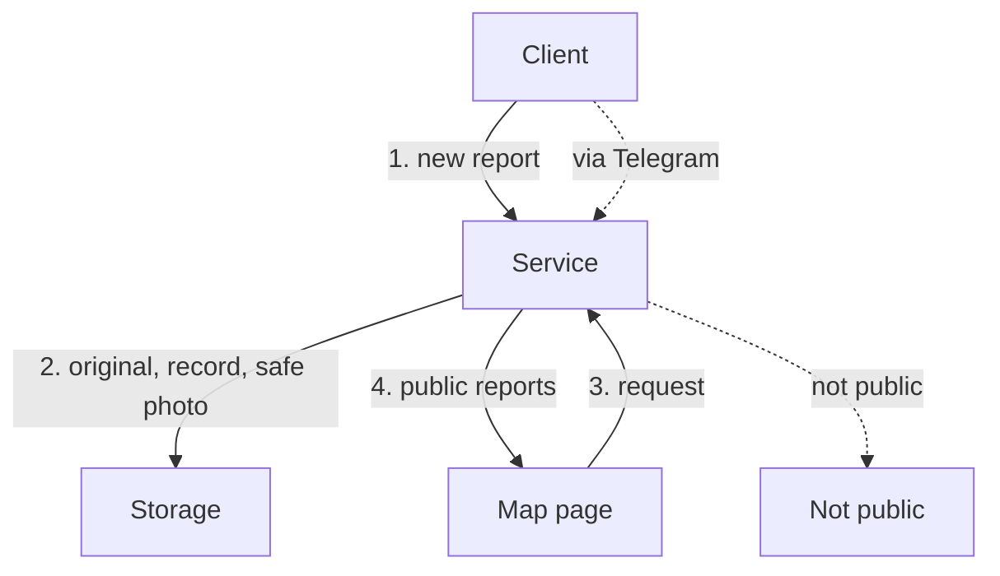

# From a phone to the map

*For: Tech lead*

**Goal.** A user sends a photo of a street problem, and the report is shown on a public map.

- Public only after a safe photo: failure means never shown, and not at once.
- Originals stay private; cost is two files and a worker.
- Photo check is an outside service; form, photo work, and map share one place.
